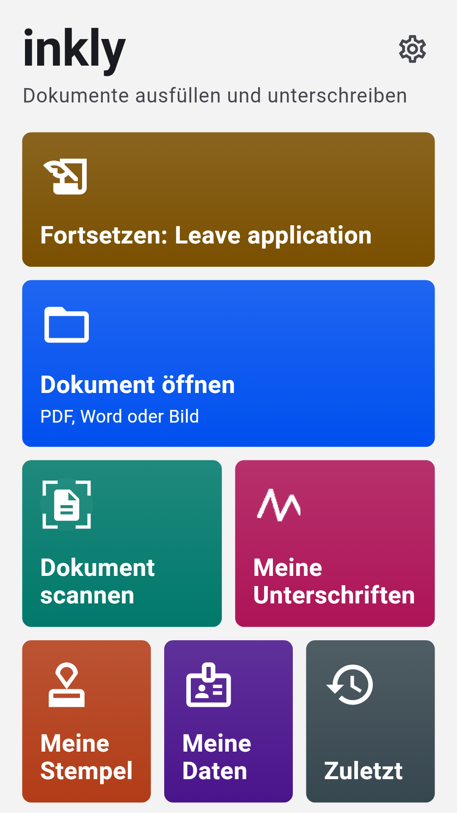
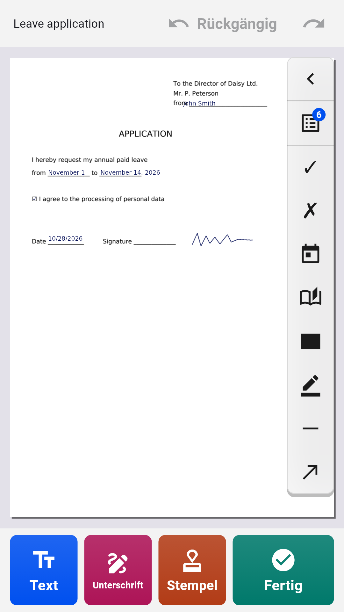
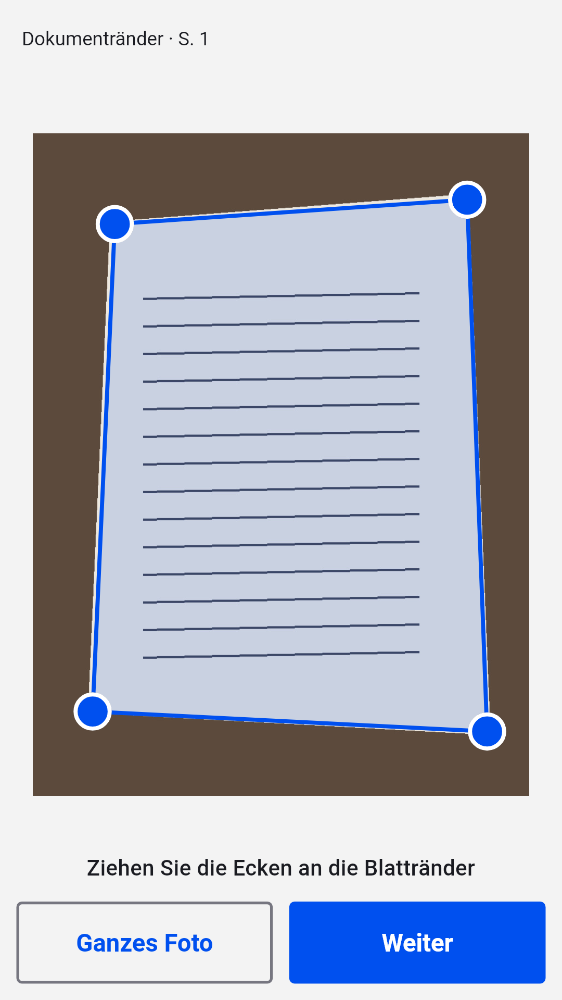
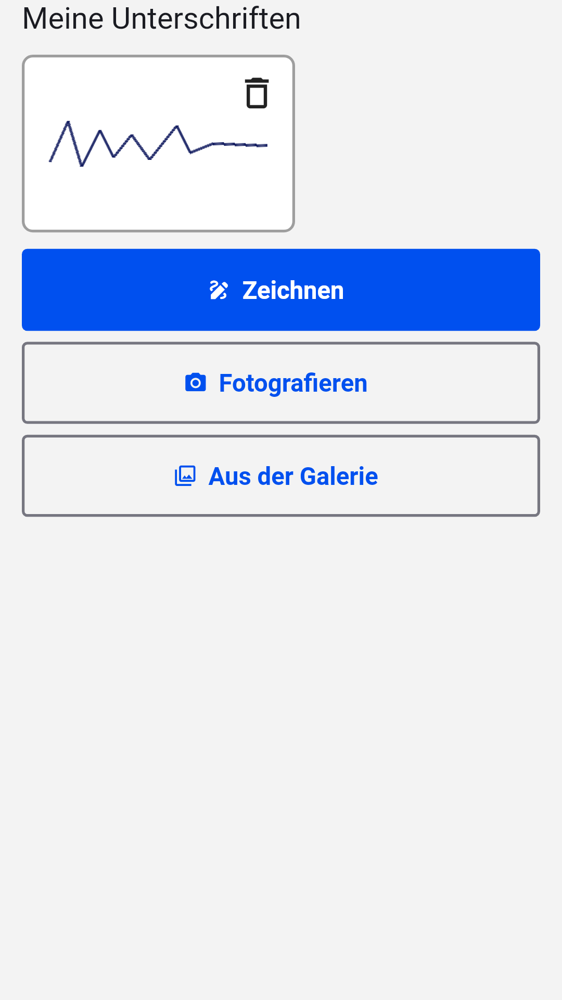

[English](README.md) · [Русский](README.ru.md) · [Українська](README.uk.md) · [Қазақша](README.kk.md) · **Deutsch** · [Español](README.es.md) · [Français](README.fr.md) · [Português](README.pt.md) · [Türkçe](README.tr.md)

# Inkly

**PDF, Word und Fotos von Dokumenten auf Android ausfüllen und unterschreiben**

Öffnen Sie einen Antrag, ein Formular oder einen Vertrag, schreiben Sie direkt auf die Seite, fügen Sie Unterschrift und Stempel hinzu und speichern Sie ein fertiges PDF. Kein Konto, kein Abo: Die Dokumente werden auf Ihrem Telefon verarbeitet.

  
  
  
  

## Herunterladen

Laden Sie die neueste `inkly-<Version>.apk` unter [Releases](https://github.com/Anton247/inkly-releases/releases/latest) herunter und öffnen Sie sie auf dem Telefon (erlauben Sie die Installation aus dieser Quelle, falls gefragt). Android 7.0 oder neuer.

Die App sucht selbst nach neuen Versionen.

## Funktionen

- PDF, Word (DOC, DOCX) oder ein Foto eines Papierdokuments: Der Scanner findet das Blatt, richtet es gerade und erstellt ein mehrseitiges PDF
- Schreiben Sie an beliebiger Stelle; Felder von PDF-Formularen werden hervorgehoben, Kontrollkästchen und Listen funktionieren
- Ihre Daten griffbereit: Name, Adresse, Ausweis, eigene Felder – auch für Ihre Familie
- Unterschrift und Firmenstempel: mit dem Finger zeichnen oder auf Papier fotografieren, der Hintergrund wird entfernt
- Seiten: sortieren, drehen, löschen, leere oder gescannte hinzufügen, mehrere Dateien zusammenführen
- Schwärzen: verdeckter Text wird wirklich aus der Datei entfernt
- Was Sie sehen, wird gespeichert: PDF-Vorschau, Komprimierung und Passwort; speichern, teilen oder drucken
- Jede Schrift: Lateinisch, Kyrillisch, Griechisch, Hebräisch, Arabisch, Chinesisch, Japanisch, Koreanisch, Hindi, Thai und Dutzende mehr – Schriftarten integriert
- App-Sperre per Fingerabdruck, Gesicht oder PIN; dunkles Design, TalkBack, 9 Sprachen

## Kostenlos

Die App ist dank Yandex-Werbung kostenlos: unten ein Banner, Vollbildwerbung nur nach dem Speichern, Teilen oder Drucken. Sehen Sie sich ein kurzes Video an, und die nächsten 5 Dokumente kommen ohne sie aus.

## Zur Unterschrift

Inkly setzt ein Bild Ihrer handschriftlichen Unterschrift auf das Dokument – als hätten Sie auf Papier unterschrieben und das Blatt gescannt. Es ist keine qualifizierte elektronische Signatur.

---

[Datenschutzerklärung](https://anton247.github.io/inkly-releases/privacy#inkly-privacy-policy) · Dieses Repository enthält nur fertige Builds.
