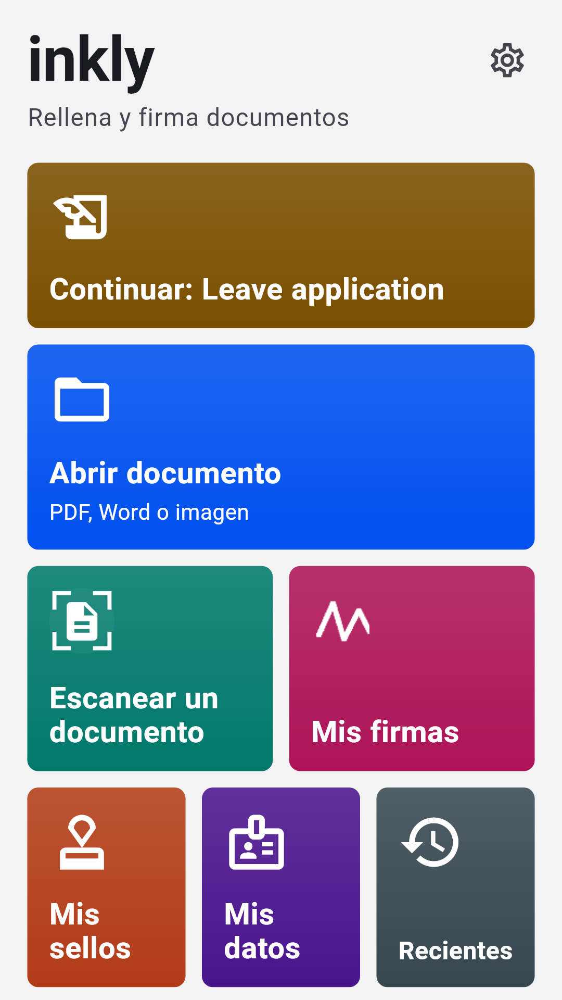
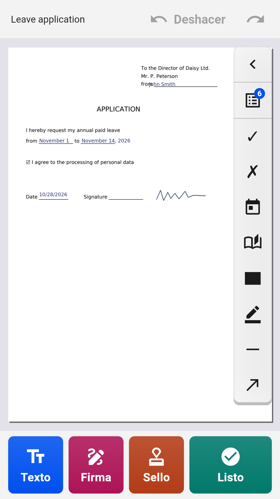
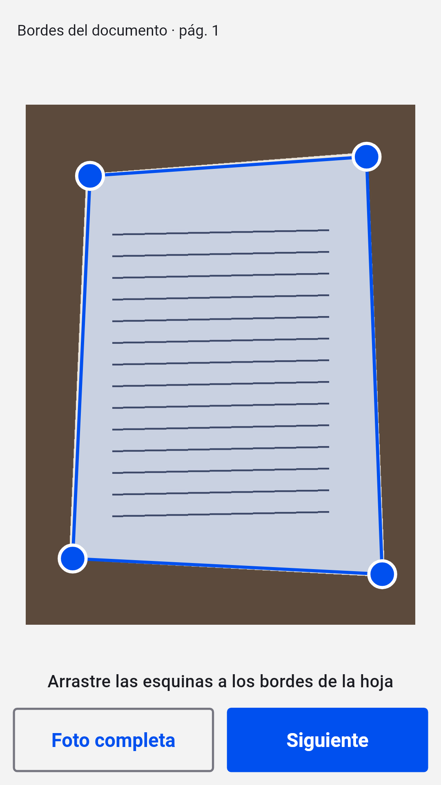
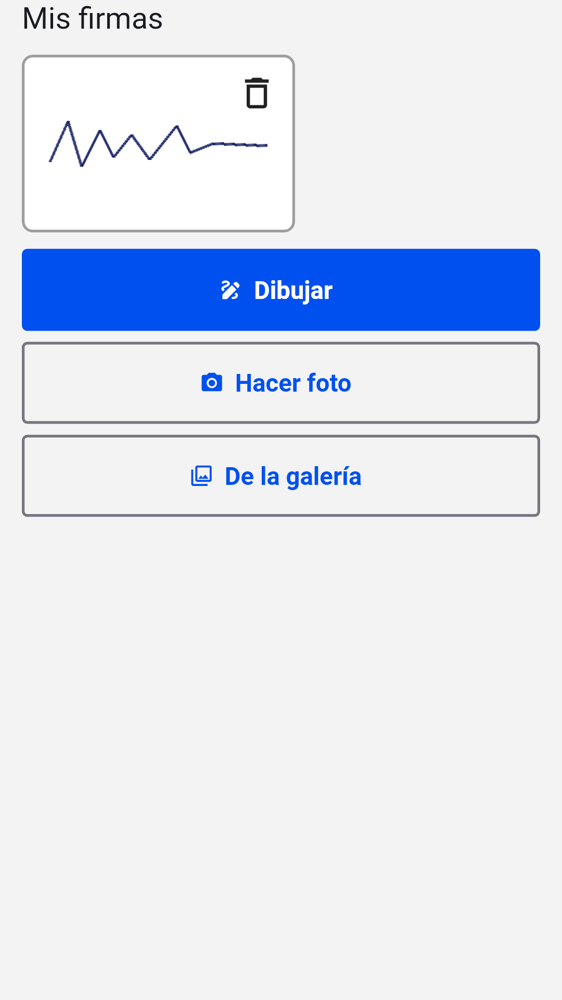

[English](README.md) · [Русский](README.ru.md) · [Українська](README.uk.md) · [Қазақша](README.kk.md) · [Deutsch](README.de.md) · **Español** · [Français](README.fr.md) · [Português](README.pt.md) · [Türkçe](README.tr.md)

# Inkly

**Rellena y firma PDF, Word y fotos de documentos en Android**

Abre una solicitud, un formulario o un contrato, escribe directamente en la página, añade tu firma y tu sello y guarda un PDF terminado. Sin cuenta ni suscripción: los documentos se procesan en tu teléfono.

  
  
  
  

## Descargar

Descarga el último `inkly-<versión>.apk` desde [Releases](https://github.com/Anton247/inkly-releases/releases/latest) y ábrelo en el teléfono (permite la instalación desde esta fuente si te lo pide). Requiere Android 7.0 o posterior.

La app busca nuevas versiones por sí sola.

## Funciones

- PDF, Word (DOC, DOCX) o la foto de un documento en papel: el escáner encuentra la hoja, la endereza y crea un PDF de varias páginas
- Escribe en cualquier parte de la página; los campos de los formularios PDF se resaltan, las casillas y las listas funcionan
- Tus datos a mano: nombre, dirección, documento de identidad, campos propios, y lo mismo para tu familia
- Firma y sello de empresa: dibújalos con el dedo o fotografíalos en papel, el fondo se elimina solo
- Páginas: reordenar, girar, eliminar, añadir en blanco o escaneadas, unir varios archivos
- Tachado: el texto oculto se elimina de verdad del archivo
- Lo que ves es lo que guardas: vista previa del PDF, compresión y contraseña; guarda, comparte o imprime
- Cualquier escritura: latina, cirílica, griega, hebrea, árabe, china, japonesa, coreana, hindi, tailandesa y decenas más, con fuentes integradas
- Bloqueo con huella, rostro o PIN; tema oscuro, TalkBack, 9 idiomas

## Gratis

La app es gratuita gracias a los anuncios de Yandex: un banner abajo y un anuncio a pantalla completa solo después de guardar, compartir o imprimir. Mira un vídeo corto y los próximos 5 documentos irán sin él.

## Sobre la firma

Inkly coloca en el documento una imagen de tu firma manuscrita, como si firmaras en papel y escanearas la hoja. No es una firma electrónica cualificada.

---

[Política de privacidad](https://anton247.github.io/inkly-releases/privacy#inkly-privacy-policy) · Este repositorio solo contiene las compilaciones publicadas.
