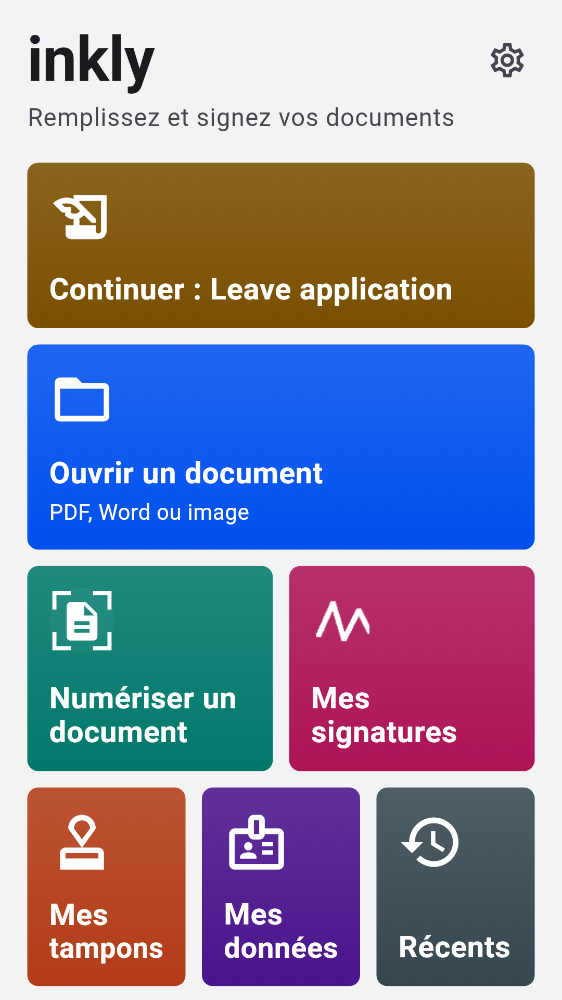
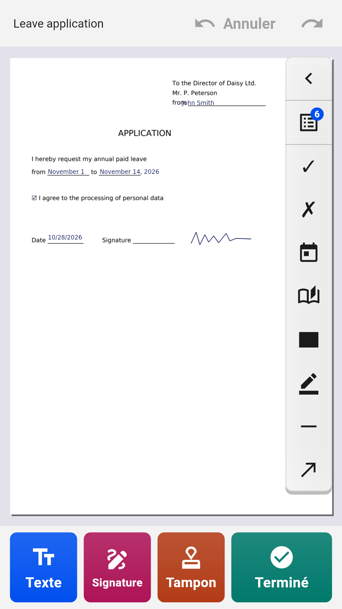
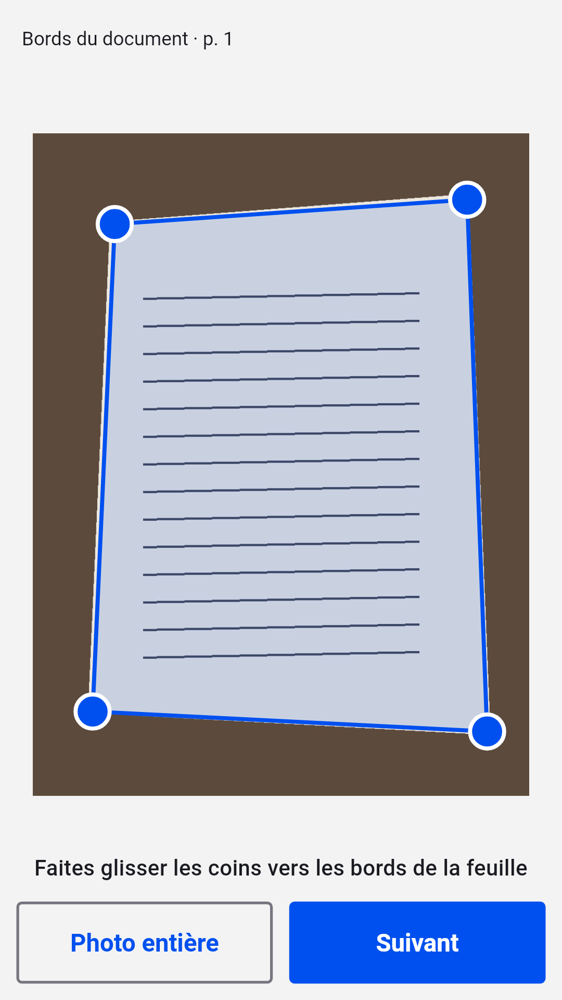
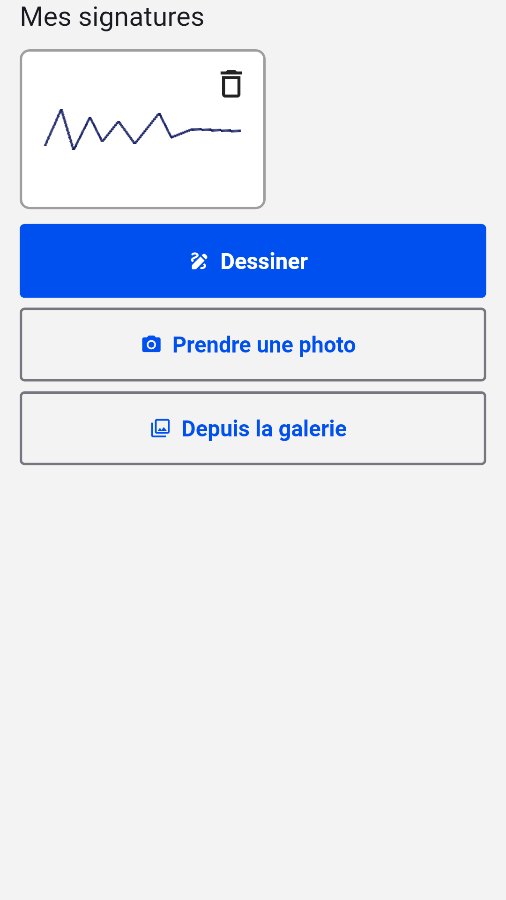

[English](README.md) · [Русский](README.ru.md) · [Українська](README.uk.md) · [Қазақша](README.kk.md) · [Deutsch](README.de.md) · [Español](README.es.md) · **Français** · [Português](README.pt.md) · [Türkçe](README.tr.md)

# Inkly

**Remplissez et signez des PDF, des fichiers Word et des photos de documents sur Android**

Ouvrez une demande, un formulaire ou un contrat, écrivez directement sur la page, ajoutez votre signature et votre tampon, puis enregistrez un PDF prêt. Sans compte ni abonnement : les documents sont traités sur votre téléphone.

  
  
  
  

## Télécharger

Téléchargez le dernier `inkly-<version>.apk` dans [Releases](https://github.com/Anton247/inkly-releases/releases/latest) et ouvrez-le sur votre téléphone (autorisez l’installation depuis cette source si on vous le demande). Android 7.0 ou plus récent.

L’application vérifie elle-même les nouvelles versions.

## Fonctionnalités

- PDF, Word (DOC, DOCX) ou photo d’un document papier : le scanner trouve la feuille, la redresse et crée un PDF de plusieurs pages
- Écrivez n’importe où sur la page ; les champs des formulaires PDF sont mis en évidence, les cases à cocher et les listes fonctionnent
- Vos informations à portée de main : nom, adresse, pièce d’identité, champs personnalisés, et de même pour vos proches
- Signature et tampon d’entreprise : dessinez-les au doigt ou photographiez-les sur papier, le fond est supprimé
- Pages : réordonner, faire pivoter, supprimer, ajouter des pages vierges ou scannées, fusionner plusieurs fichiers
- Caviardage : le texte masqué est réellement supprimé du fichier
- Ce que vous voyez est ce que vous enregistrez : aperçu du PDF, compression et mot de passe ; enregistrez, partagez ou imprimez
- Toutes les écritures : latin, cyrillique, grec, hébreu, arabe, chinois, japonais, coréen, hindi, thaï et des dizaines d’autres, polices intégrées
- Verrouillage par empreinte, visage ou code PIN ; thème sombre, TalkBack, 9 langues

## Gratuit

L’application est gratuite grâce aux publicités Yandex : une bannière en bas, et une publicité plein écran seulement après un enregistrement, un partage ou une impression. Regardez une courte vidéo et les 5 documents suivants s’en passeront.

## À propos de la signature

Inkly place sur le document une image de votre signature manuscrite, comme si vous signiez sur papier puis scanniez la feuille. Ce n’est pas une signature électronique qualifiée.

---

[Politique de confidentialité](https://anton247.github.io/inkly-releases/privacy#inkly-privacy-policy) · Ce dépôt contient uniquement les versions publiées.
