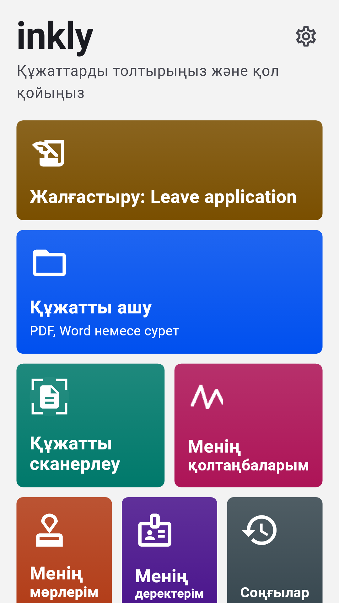
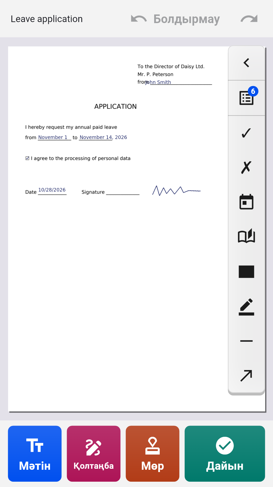
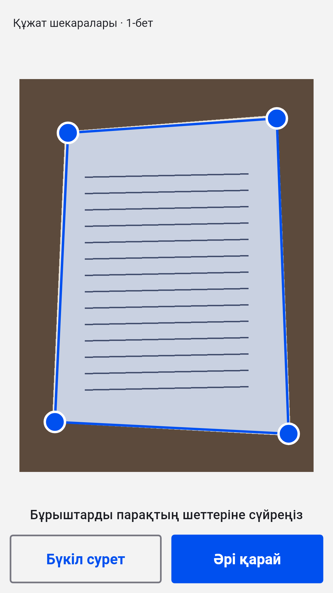
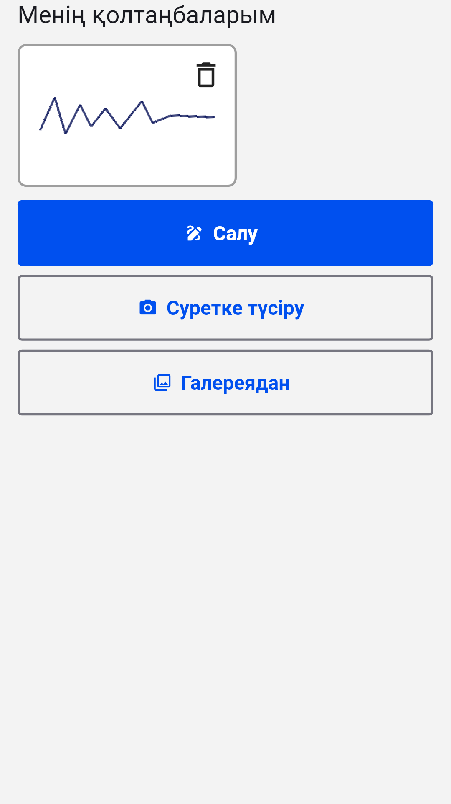

[English](README.md) · [Русский](README.ru.md) · [Українська](README.uk.md) · **Қазақша** · [Deutsch](README.de.md) · [Español](README.es.md) · [Français](README.fr.md) · [Português](README.pt.md) · [Türkçe](README.tr.md)

# Inkly

**Android-та PDF, Word және құжат фотосуреттерін толтырып, қол қойыңыз**

Өтінішті, сауалнаманы немесе шартты ашыңыз, мәтінді тікелей бетке жазыңыз, қолтаңба мен мөрді қойып, дайын PDF сақтаңыз. Тіркелусіз және жазылымсыз: құжаттар телефонның өзінде өңделеді.

  
  
  
  

## Жүктеп алу

Соңғы `inkly-<нұсқа>.apk` файлын [Releases](https://github.com/Anton247/inkly-releases/releases/latest) бөлімінен жүктеп алып, телефонда ашыңыз (телефон сұраса, осы көзден орнатуға рұқсат беріңіз). Android 7.0 немесе одан жаңасы қажет.

Қолданба жаңа нұсқаларды өзі тексереді.

## Мүмкіндіктер

- PDF, Word (DOC, DOCX) немесе қағаз құжаттың фотосы: сканер парақты тауып, түзетеді және көп беттік PDF жасайды
- Беттің кез келген жеріне жазыңыз; PDF бланкілерінің өрістері ерекшеленеді, белгілер мен тізімдер жұмыс істейді
- Деректеріңіз әрдайым қолыңызда: аты-жөні, мекенжай, құжат, өз өрістеріңіз — жақындарыңыз үшін де
- Қолтаңба мен мөр: саусақпен салыңыз немесе қағаздан суретке түсіріңіз, фон өзі жойылады
- Беттер: ретін өзгерту, бұру, жою, бос және сканерленген беттер қосу, файлдарды біріктіру
- Бояу: жасырылған мәтін файлдан шын мәнінде жойылады
- Не көрсеңіз, сол сақталады: PDF алдын ала қарау, сығу және құпиясөз, сақтау, жіберу және басып шығару
- Кез келген жазу: латын, кирилл, грек, иврит, араб, қытай, жапон, корей, хинди, тай және ондаған басқа — қаріптер кірістірілген
- Саусақ ізі, бет немесе PIN-код арқылы кіру; қараңғы тақырып, TalkBack, интерфейстің 9 тілі

## Тегін

Қолданба Яндекс жарнамасының арқасында тегін: төменде баннер, ал толық экранды жарнама тек сақтағаннан, жібергеннен немесе басып шығарғаннан кейін көрсетіледі. Қысқа роликті көріңіз — келесі 5 құжат онсыз өтеді.

## Қолтаңба туралы

Inkly құжатқа өз қолыңызбен қойған қолтаңбаның суретін қояды — қағазға қол қойып, парақты сканерлегендей. Бұл білікті электрондық цифрлық қолтаңба (ЭЦҚ) емес.

---

[Құпиялылық саясаты](https://anton247.github.io/inkly-releases/privacy#inkly-privacy-policy) · Бұл репозиторийде тек дайын жинақтар бар.
