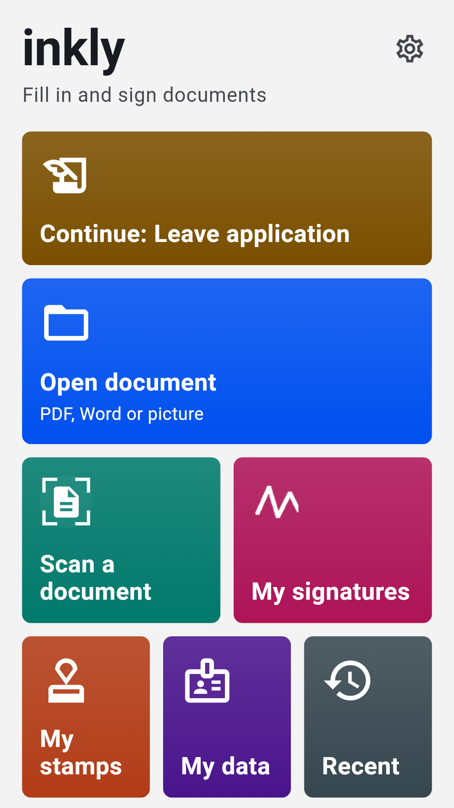
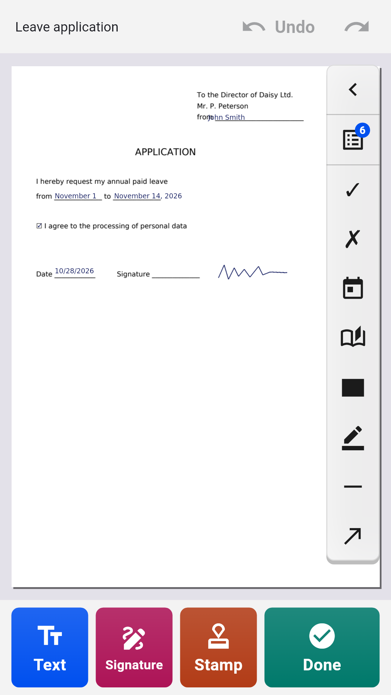
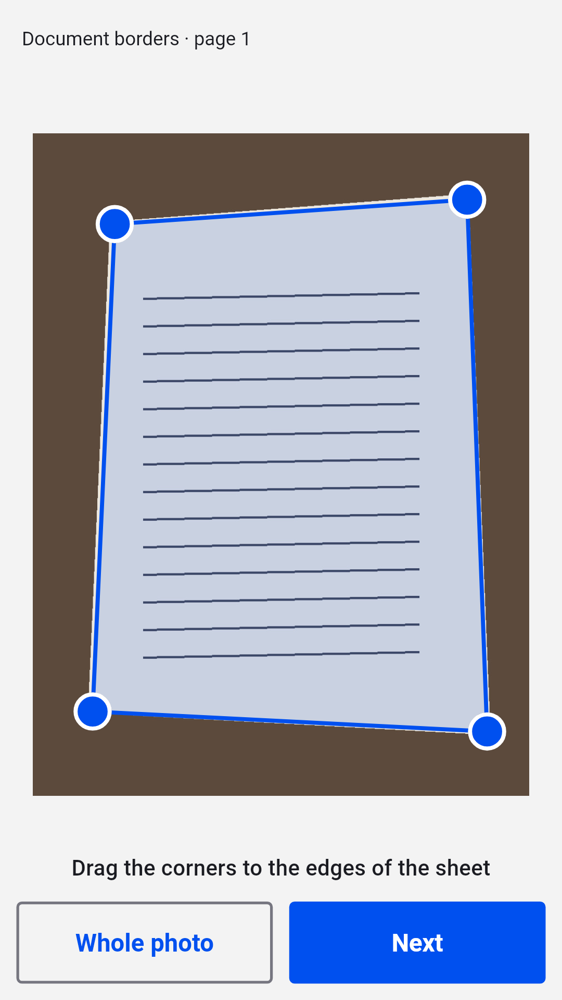
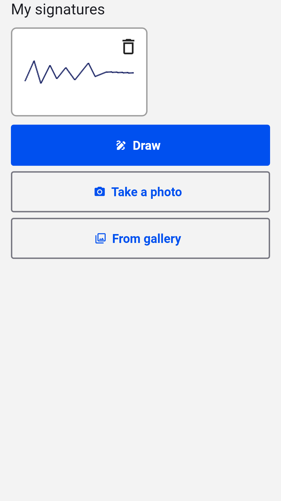

**English** · [Русский](README.ru.md) · [Українська](README.uk.md) · [Қазақша](README.kk.md) · [Deutsch](README.de.md) · [Español](README.es.md) · [Français](README.fr.md) · [Português](README.pt.md) · [Türkçe](README.tr.md)

# Inkly

**Fill in and sign PDF, Word and photos of documents on Android**

Open an application, form or contract, type right on the page, add your signature and stamp and save a finished PDF. No account, no subscription: documents are processed on your phone.

  
  
  
  

## Download

Get the latest `inkly-<version>.apk` from [Releases](https://github.com/Anton247/inkly-releases/releases/latest) and open it on your phone (allow installing from this source if asked). Android 7.0 or newer.

The app checks for new versions by itself.

## Features

- PDF, Word (DOC, DOCX) or a photo of a paper document: the scanner finds the sheet, straightens it and makes a multi-page PDF
- Type anywhere on the page; PDF form fields are highlighted, checkboxes and lists work
- Your details one tap away: name, address, ID document, your own fields, and the same for your family
- Signature and company stamp: draw them with a finger or photograph them on paper, the background is removed
- Pages: reorder, rotate, delete, add blank or scanned ones, merge several files
- Black out text and it is really removed from the file
- What you see is what you save: preview the PDF, compress it or protect it with a password, then save, share or print
- Any script: Latin, Cyrillic, Greek, Hebrew, Arabic, Chinese, Japanese, Korean, Hindi, Thai and dozens more, fonts built in
- App lock with fingerprint, face or PIN; dark theme, TalkBack, 9 interface languages

## Free

The app is free thanks to Yandex ads: a banner at the bottom, and a full-screen ad only after you save, share or print. Watch a short video and the next 5 documents go without it.

## About the signature

Inkly places an image of your handwritten signature on the document, just as if you signed on paper and scanned the sheet. It is not a qualified electronic signature.

---

[Privacy policy](https://anton247.github.io/inkly-releases/privacy#inkly-privacy-policy) · This repository holds release builds only.
