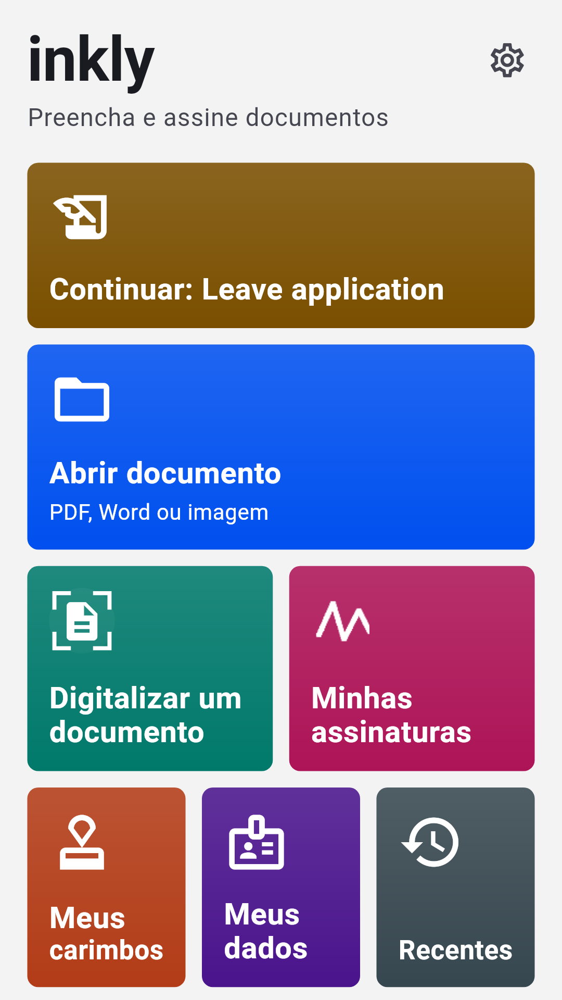
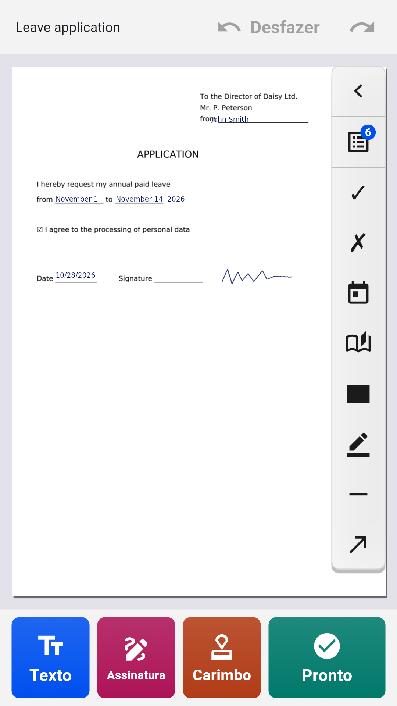
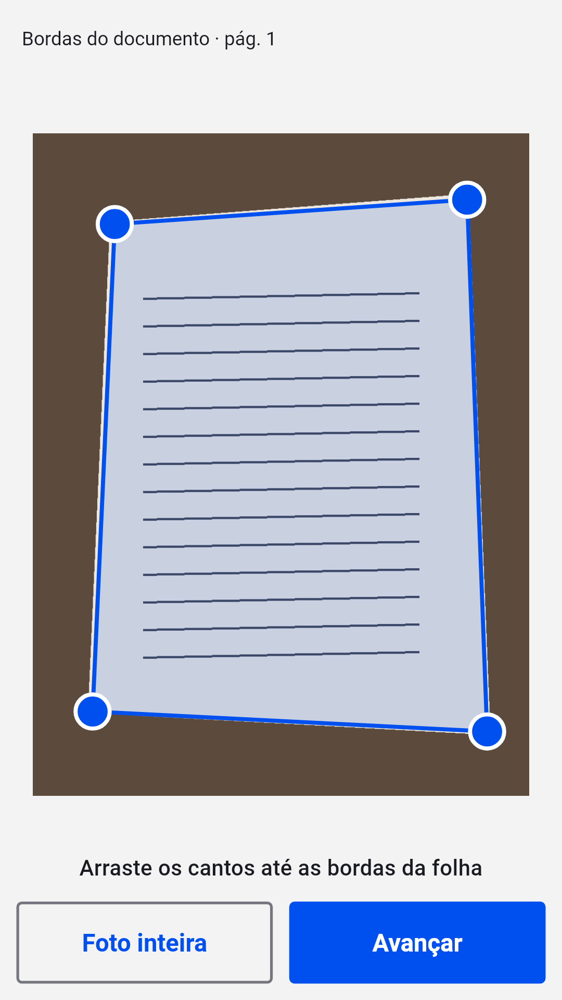
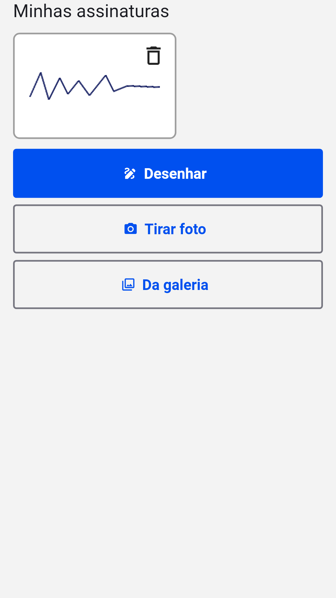

[English](README.md) · [Русский](README.ru.md) · [Українська](README.uk.md) · [Қазақша](README.kk.md) · [Deutsch](README.de.md) · [Español](README.es.md) · [Français](README.fr.md) · **Português** · [Türkçe](README.tr.md)

# Inkly

**Preencha e assine PDF, Word e fotos de documentos no Android**

Abra um requerimento, um formulário ou um contrato, escreva diretamente na página, adicione sua assinatura e seu carimbo e salve um PDF pronto. Sem conta e sem mensalidade: os documentos são processados no seu celular.

  
  
  
  

## Baixar

Baixe o `inkly-<versão>.apk` mais recente em [Releases](https://github.com/Anton247/inkly-releases/releases/latest) e abra-o no celular (permita a instalação desta fonte, se for solicitado). Requer Android 7.0 ou mais recente.

O app verifica novas versões sozinho.

## Recursos

- PDF, Word (DOC, DOCX) ou foto de um documento em papel: o scanner encontra a folha, endireita e cria um PDF de várias páginas
- Escreva em qualquer lugar da página; os campos de formulários PDF são destacados, caixas de seleção e listas funcionam
- Seus dados à mão: nome, endereço, documento de identidade, campos próprios, e o mesmo para sua família
- Assinatura e carimbo da empresa: desenhe com o dedo ou fotografe no papel, o fundo é removido
- Páginas: reordenar, girar, excluir, adicionar em branco ou digitalizadas, juntar vários arquivos
- Tarja: o texto coberto é realmente removido do arquivo
- O que você vê é o que você salva: prévia do PDF, compressão e senha; salve, compartilhe ou imprima
- Qualquer escrita: latina, cirílica, grega, hebraica, árabe, chinesa, japonesa, coreana, hindi, tailandesa e dezenas de outras, com fontes incluídas
- Bloqueio por digital, rosto ou PIN; tema escuro, TalkBack, 9 idiomas

## Grátis

O app é gratuito graças aos anúncios da Yandex: um banner embaixo e anúncio em tela cheia só depois de salvar, compartilhar ou imprimir. Assista a um vídeo curto e os próximos 5 documentos ficam sem ele.

## Sobre a assinatura

O Inkly coloca no documento uma imagem da sua assinatura de próprio punho, como se você assinasse no papel e digitalizasse a folha. Não é uma assinatura eletrônica qualificada.

---

[Política de privacidade](https://anton247.github.io/inkly-releases/privacy#inkly-privacy-policy) · Este repositório contém apenas as versões publicadas.
