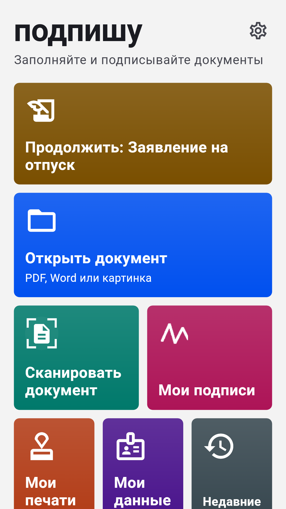
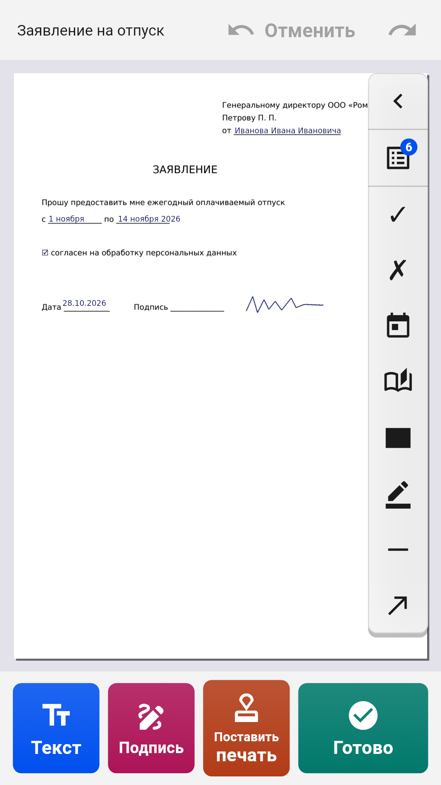
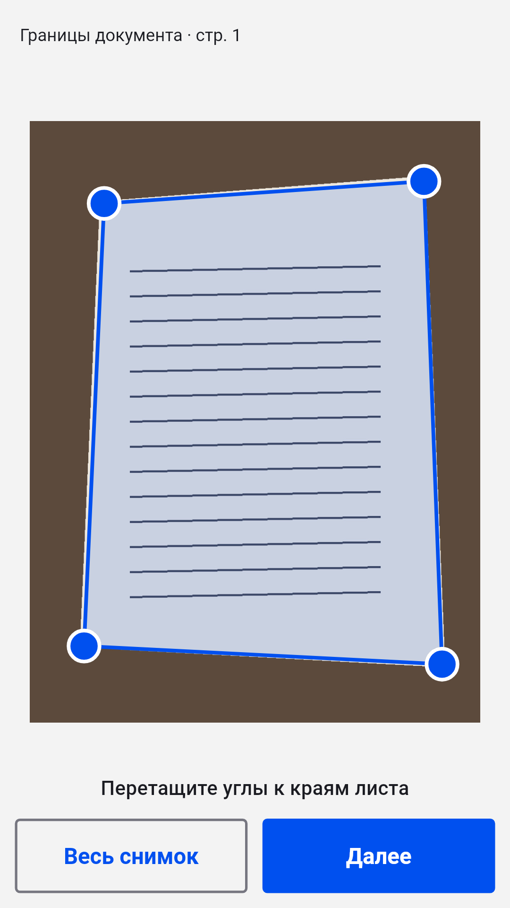
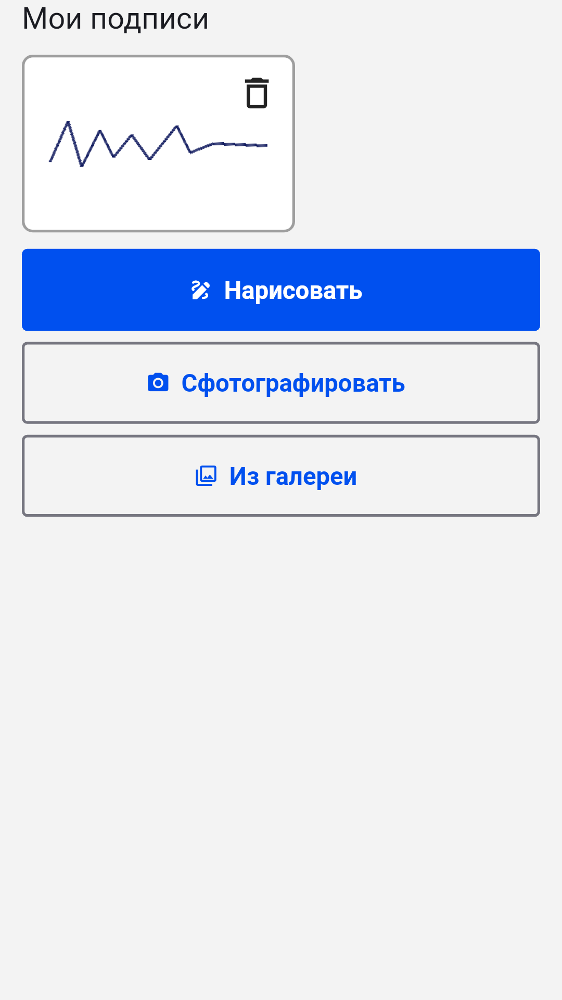

[English](README.md) · **Русский** · [Українська](README.uk.md) · [Қазақша](README.kk.md) · [Deutsch](README.de.md) · [Español](README.es.md) · [Français](README.fr.md) · [Português](README.pt.md) · [Türkçe](README.tr.md)

# Подпишу

**Заполняйте и подписывайте PDF, Word и фото документов на Android**

Откройте заявление, анкету или договор, впишите текст прямо на странице, поставьте подпись и печать и сохраните готовый PDF. Без регистрации и подписки: документы обрабатываются на самом телефоне.

  
  
  
  

## Скачать

Скачайте последний `inkly-<версия>.apk` в разделе [Releases](https://github.com/Anton247/inkly-releases/releases/latest) и откройте его на телефоне (разрешите установку из этого источника, если телефон спросит). Нужен Android 7.0 или новее.

Приложение есть и в [RuStore](https://www.rustore.ru/catalog/app/ru.podpishu.app).

Приложение само проверяет новые версии.

## Возможности

- PDF, Word (DOC, DOCX) или фото бумажного документа: сканер находит лист, выравнивает его и собирает многостраничный PDF
- Печатайте в любом месте страницы; поля PDF-бланков подсвечиваются, работают галочки и списки
- Ваши данные под рукой: ФИО, адрес, документ, свои поля — и то же для близких
- Подпись и печать: нарисуйте пальцем или сфотографируйте на бумаге, фон уберётся сам
- Страницы: порядок, поворот, удаление, пустые и отсканированные страницы, объединение файлов
- Закрашивание: скрытый текст удаляется из файла по-настоящему
- Что видите, то и сохраните: просмотр PDF, сжатие и пароль, сохранение, отправка и печать
- Любые языки: латиница, кириллица, греческий, иврит, арабский, китайский, японский, корейский, хинди, тайский и десятки других — шрифты встроены
- Вход по отпечатку, лицу или ПИН-коду; тёмная тема, TalkBack, 9 языков интерфейса

## Бесплатно

Приложение бесплатное благодаря рекламе Яндекса: внизу баннер, а полноэкранная реклама — только после сохранения, отправки или печати. Посмотрите короткий ролик — и 5 документов пройдут без неё.

## О подписи

«Подпишу» ставит на документ изображение вашей собственноручной подписи — как если бы вы расписались на бумаге и отсканировали лист. Это не квалифицированная электронная подпись (КЭП).

---

[Политика конфиденциальности](https://anton247.github.io/inkly-releases/privacy) · В этом репозитории только готовые сборки.
