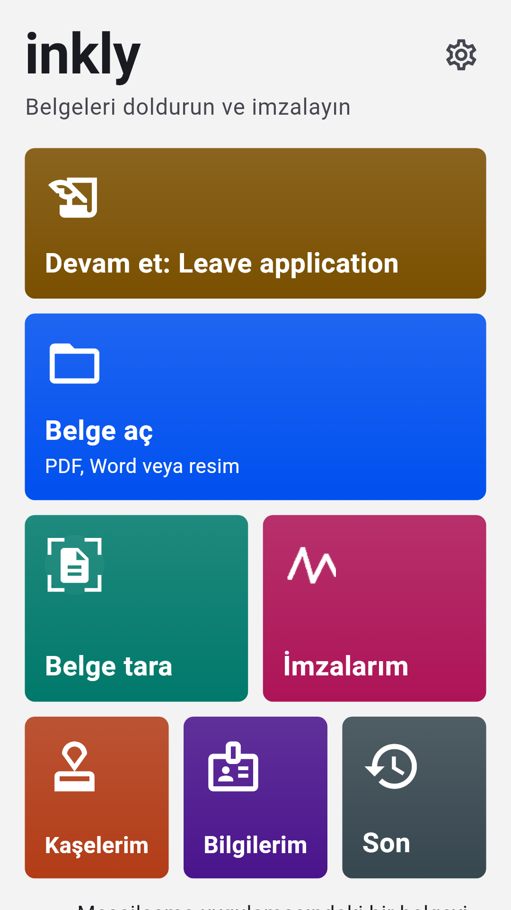
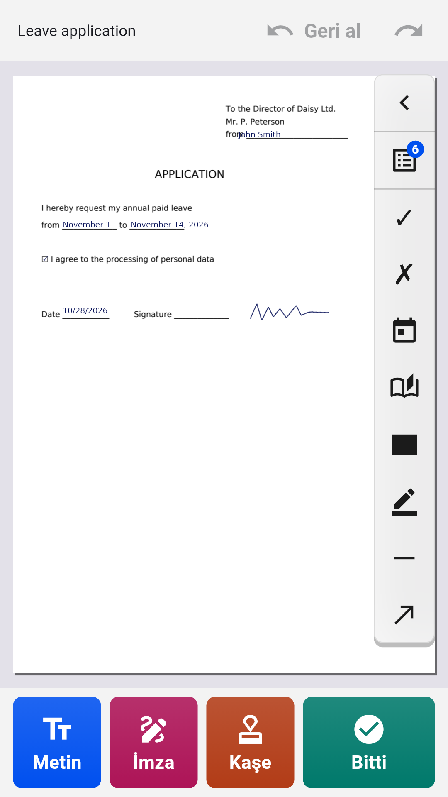
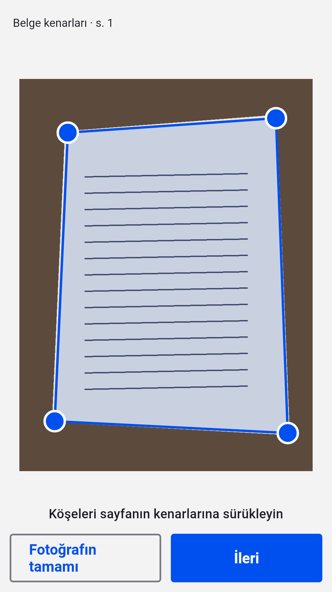
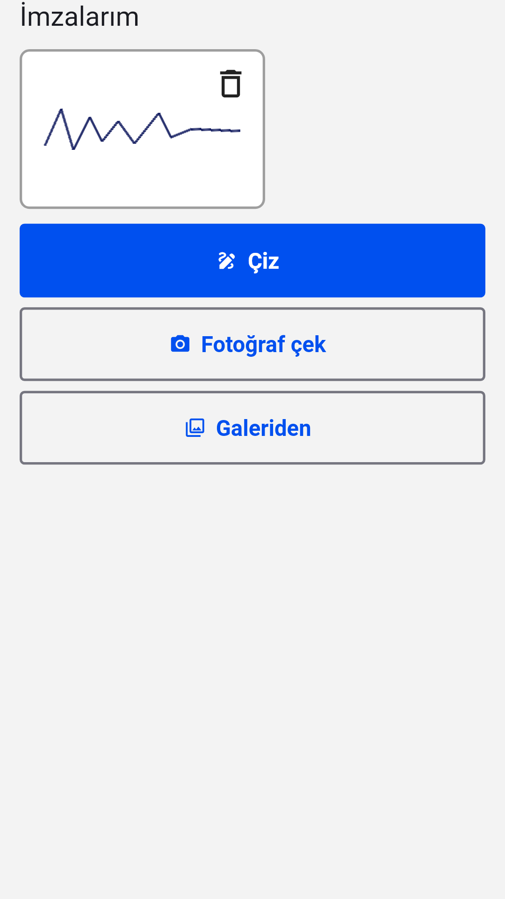

[English](README.md) · [Русский](README.ru.md) · [Українська](README.uk.md) · [Қазақша](README.kk.md) · [Deutsch](README.de.md) · [Español](README.es.md) · [Français](README.fr.md) · [Português](README.pt.md) · **Türkçe**

# Inkly

**Android’de PDF, Word ve belge fotoğraflarını doldurun ve imzalayın**

Bir dilekçe, form veya sözleşme açın, doğrudan sayfaya yazın, imzanızı ve kaşenizi ekleyin ve hazır bir PDF kaydedin. Hesap yok, abonelik yok: belgeler telefonunuzda işlenir.

  
  
  
  

## İndir

En son `inkly-<sürüm>.apk` dosyasını [Releases](https://github.com/Anton247/inkly-releases/releases/latest) bölümünden indirin ve telefonunuzda açın (sorulursa bu kaynaktan yüklemeye izin verin). Android 7.0 veya üstü gerekir.

Uygulama yeni sürümleri kendisi denetler.

## Özellikler

- PDF, Word (DOC, DOCX) veya kâğıt belgenin fotoğrafı: tarayıcı sayfayı bulur, düzeltir ve çok sayfalı bir PDF oluşturur
- Sayfanın herhangi bir yerine yazın; PDF formlarının alanları vurgulanır, onay kutuları ve listeler çalışır
- Bilgileriniz elinizin altında: ad soyad, adres, kimlik belgesi, kendi alanlarınız; aileniz için de
- İmza ve şirket kaşesi: parmağınızla çizin veya kâğıttan fotoğrafını çekin, arka plan kaldırılır
- Sayfalar: sıralama, döndürme, silme, boş veya taranmış sayfa ekleme, birden çok dosyayı birleştirme
- Karartma: gizlenen metin dosyadan gerçekten silinir
- Ne görüyorsanız o kaydedilir: PDF önizleme, sıkıştırma ve parola; kaydedin, paylaşın veya yazdırın
- Her yazı sistemi: Latin, Kiril, Yunan, İbrani, Arap, Çin, Japon, Kore, Hint, Tay ve onlarca başka, yazı tipleri dahil
- Parmak izi, yüz veya PIN ile kilit; koyu tema, TalkBack, 9 dil

## Ücretsiz

Uygulama Yandex reklamları sayesinde ücretsizdir: altta bir banner, tam ekran reklam ise yalnızca kaydettikten, paylaştıktan veya yazdırdıktan sonra. Kısa bir video izleyin, sonraki 5 belge reklamsız geçsin.

## İmza hakkında

Inkly belgeye el yazısı imzanızın bir görüntüsünü koyar; tıpkı kâğıda imza atıp sayfayı taramışsınız gibi. Bu nitelikli elektronik imza değildir.

---

[Gizlilik politikası](https://anton247.github.io/inkly-releases/privacy#inkly-privacy-policy) · Bu depoda yalnızca yayımlanmış sürümler bulunur.
