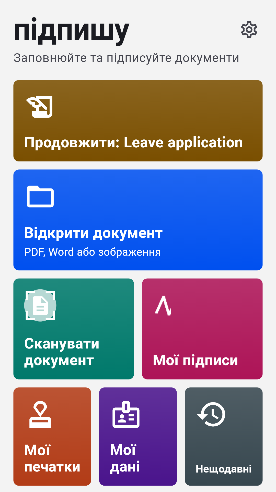
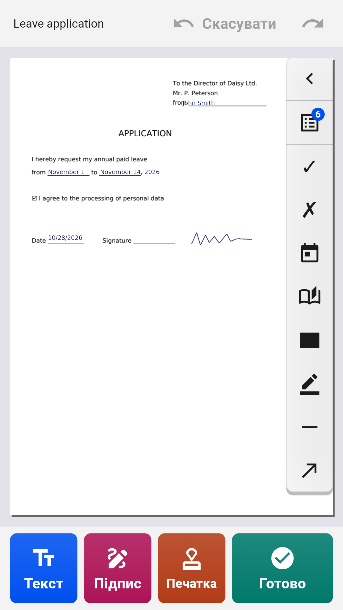
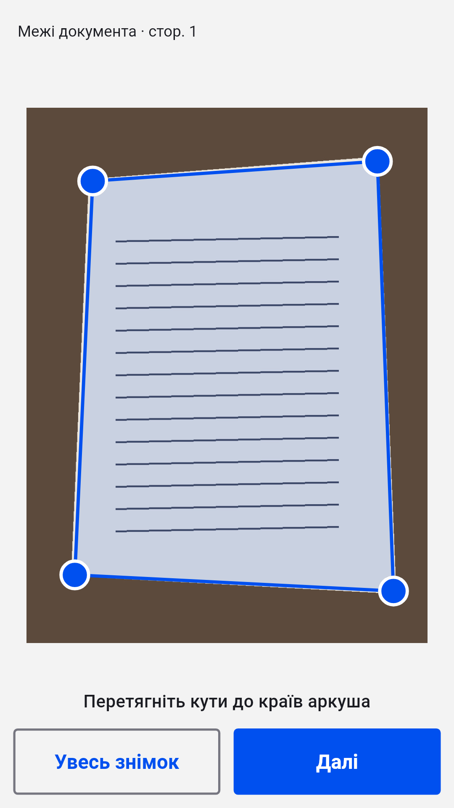
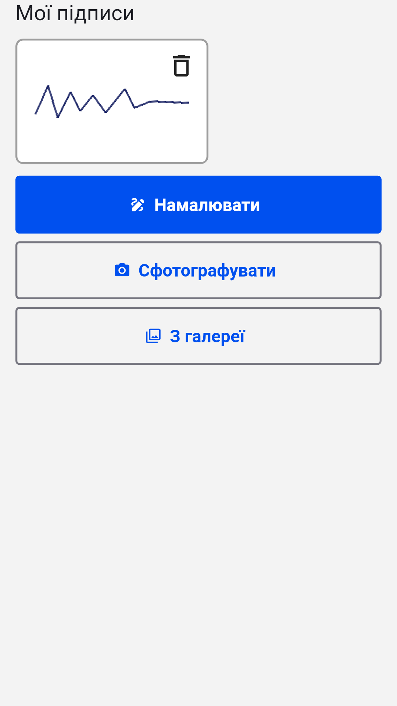

[English](README.md) · [Русский](README.ru.md) · **Українська** · [Қазақша](README.kk.md) · [Deutsch](README.de.md) · [Español](README.es.md) · [Français](README.fr.md) · [Português](README.pt.md) · [Türkçe](README.tr.md)

# Підпишу

**Заповнюйте й підписуйте PDF, Word і фото документів на Android**

Відкрийте заяву, анкету чи договір, впишіть текст просто на сторінці, поставте підпис і печатку та збережіть готовий PDF. Без реєстрації й підписки: документи обробляються на самому телефоні.

  
  
  
  

## Завантажити

Завантажте останній `inkly-<версія>.apk` у розділі [Releases](https://github.com/Anton247/inkly-releases/releases/latest) і відкрийте його на телефоні (дозвольте встановлення з цього джерела, якщо телефон запитає). Потрібен Android 7.0 або новіший.

Застосунок сам перевіряє нові версії.

## Можливості

- PDF, Word (DOC, DOCX) або фото паперового документа: сканер знаходить аркуш, вирівнює його й збирає багатосторінковий PDF
- Друкуйте в будь-якому місці сторінки; поля PDF-бланків підсвічуються, працюють прапорці й списки
- Ваші дані під рукою: ПІБ, адреса, документ, власні поля — і те саме для близьких
- Підпис і печатка: намалюйте пальцем або сфотографуйте на папері, фон прибереться сам
- Сторінки: порядок, поворот, видалення, порожні й відскановані сторінки, об’єднання файлів
- Зафарбовування: прихований текст видаляється з файлу по-справжньому
- Що бачите, те й збережете: перегляд PDF, стиснення й пароль, збереження, надсилання та друк
- Будь-які мови: латиниця, кирилиця, грецька, іврит, арабська, китайська, японська, корейська, гінді, тайська й десятки інших — шрифти вбудовані
- Вхід за відбитком, обличчям або PIN-кодом; темна тема, TalkBack, 9 мов інтерфейсу

## Безкоштовно

Застосунок безкоштовний завдяки рекламі Яндекса: унизу банер, а повноекранна реклама — лише після збереження, надсилання чи друку. Перегляньте короткий ролик — і 5 документів пройдуть без неї.

## Про підпис

«Підпишу» ставить на документ зображення вашого власноручного підпису — так, ніби ви розписалися на папері й відсканували аркуш. Це не кваліфікований електронний підпис.

---

[Політика конфіденційності](https://anton247.github.io/inkly-releases/privacy#inkly-privacy-policy) · У цьому репозиторії лише готові збірки.
